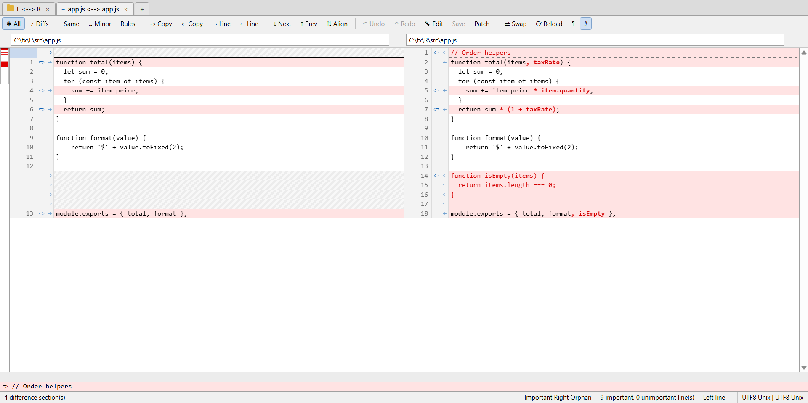
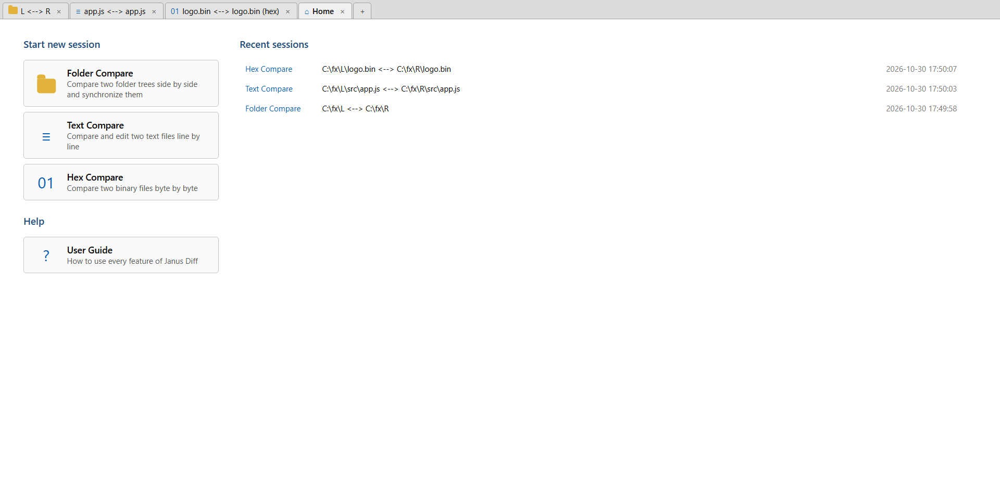
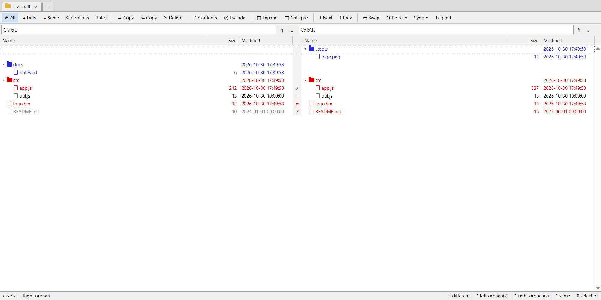
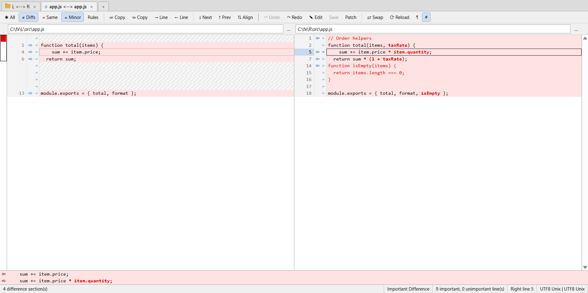
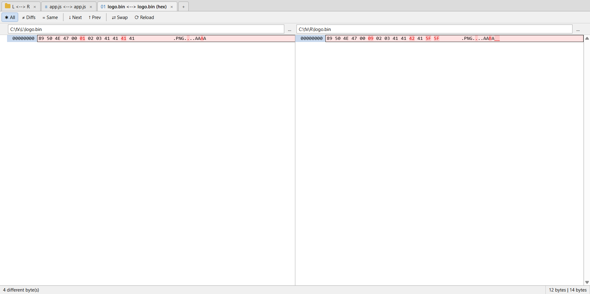
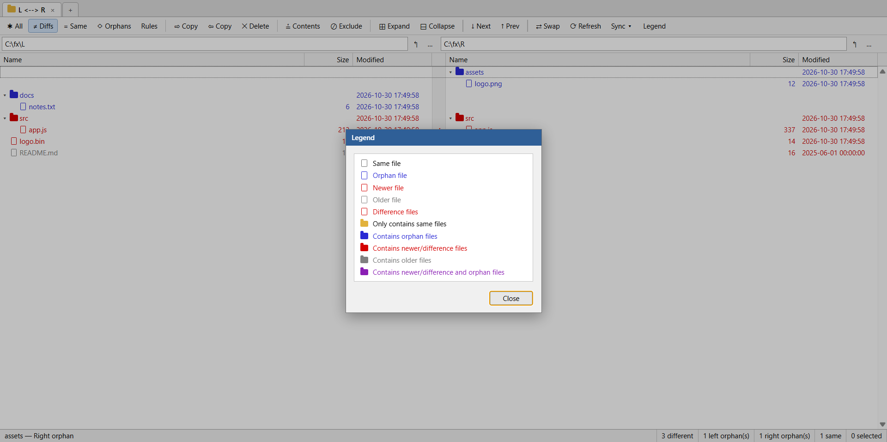

# Janus Diff

Comparador lado a lado de pastas, texto e arquivos binários (hex), em Electron.
Mostra o que mudou, deixa levar as diferenças de um lado para o outro, editar o
texto ali mesmo e salvar o resultado. Foi pensado para o uso diário com o Git e
com o menu de contexto do Explorer.



## Instalação

Baixe a versão mais recente em
[Releases](https://github.com/andrebsoares/janus_diff/releases/latest):

- `Janus.Diff.Setup.X.Y.Z.exe`: instalador, que já registra o menu de contexto
  do Explorer.
- `Janus.Diff.X.Y.Z.exe`: versão portátil, sem instalação.

Para rodar a partir do código-fonte, veja [Desenvolvimento](#desenvolvimento).

## Como usar

### 1. Comece uma comparação

A janela abre maximizada na tela inicial, com os três tipos de comparação, as
últimas 30 sessões e o guia do usuário.



Há várias formas de chegar a uma comparação:

- pela tela inicial, preenchendo os caminhos da esquerda e da direita (digitando,
  pelo botão **…** ou por **File → Open Left / Open Right**);
- arrastando arquivos ou pastas do Explorer para a janela;
- pelo [menu de contexto do Explorer](#menu-de-contexto-do-explorer-windows);
- pelo [Git](#git) ou pela [linha de comando](#linha-de-comando).

Ao abrir dois arquivos, o Janus Diff escolhe sozinho entre texto e hex. Cada
comparação fica numa aba (**Ctrl+T** abre outra), e o Janus Diff pergunta se
deseja salvar ao fechar uma aba com alterações pendentes.

### 2. Compare pastas

As duas árvores ficam alinhadas linha a linha, e a cor de cada item indica o
resultado (igual, mais novo, mais antigo, diferente ou órfão). Por padrão a
comparação usa tamanho e data; o conteúdo pode ser comparado sob demanda.



Daqui você pode filtrar a lista, comparar o conteúdo da seleção (**Ctrl+M**),
copiar itens entre os lados (**Ctrl+R** / **Ctrl+L**), sincronizar as pastas ou
abrir um par de arquivos numa nova aba com duplo clique ou **Enter**.

### 3. Compare e edite o texto

As linhas correspondentes ficam alinhadas, e os trechos alterados são destacados
dentro da linha. **Ctrl+N** / **Ctrl+P** andam entre as seções diferentes.



Para levar uma diferença para o outro lado, use **Ctrl+R** / **Ctrl+L** (seção
ou seleção), **Ctrl+Shift+R** / **Ctrl+Shift+L** (só a linha) ou as setas da
margem. Para editar, clique no texto e digite, como num editor. Nada vai para o
disco antes de **Ctrl+S**, que preserva a codificação e o fim de linha.

### 4. Compare binários

A comparação hex é feita byte a byte, posição por posição, e é somente leitura.



## Recursos

### Pastas

- **Comparação:** tamanho, data com tolerância e conteúdo (CRC, binário ou por
  regras), na sessão inteira ou só na seleção (**Ctrl+M**).
- **Filtros:** exibição (**All**, **Diffs**, **Same**, **Orphans**), máscaras de
  nome e de caminho (`*.js;-node_modules/;-/src/gen/`) e exclusão da seleção
  (**Ctrl+E**).
- **Seleção:** arrastando o mouse, com Shift/Ctrl+clique ou com Shift+setas.
- **Arquivos:** copiar, excluir (Lixeira, ou permanente quando ela não estiver
  disponível), renomear e criar pasta.
- **Sincronização:** **Update Right / Left / Both** e **Mirror to Right / Left**,
  sempre com confirmação e a contagem do que será copiado e excluído.



### Texto

- **Alinhamento:** automático, com diferenças dentro da linha, ou manual (**F7**
  numa linha, depois clique na linha correspondente do outro lado).
- **Regras de importância:** espaços no início, no meio e no fim da linha,
  maiúsculas e linhas órfãs. **≈ Minor** esconde o que não é importante.
- **Copiar entre os lados:** seção, linha ou bloco selecionado, pelas setas da
  margem, pelo botão **→ Copy N lines** ao lado da seleção, pelo menu de contexto
  ou arrastando a seleção para o outro painel. Um bloco se desfaz num único
  **Ctrl+Z**.
- **Edição livre:** um clique posiciona o cursor. **Enter** quebra a linha,
  **Backspace** e **Delete** juntam linhas, **Ctrl+V** cola várias linhas, e é
  possível digitar nas lacunas onde só o outro lado tem linha.
- **Desfazer e salvar:** até 200 passos de desfazer/refazer. **Ctrl+S** preserva
  a codificação (UTF-8, com ou sem BOM, UTF-16 LE/BE, Latin-1), o fim de linha
  (CRLF, LF, CR) e a presença de quebra de linha no fim do arquivo.
- **Navegação:** miniatura do arquivo, localizar (**Ctrl+F**), ir para a linha
  (**Ctrl+G**) e painel de detalhes da linha atual.
- **Patch:** copiar (**Ctrl+Shift+C**) ou salvar as diferenças como diff
  unificado, incluindo edições ainda não salvas.
- **Área de transferência:** comparar o texto copiado com um dos lados
  (**Ctrl+Shift+V**).
- **Arquivo alterado por outro programa:** é recarregado sozinho, e **Ctrl+Z**
  traz o texto anterior de volta. Com edições pendentes naquele lado, só avisa.

### Hex

- Bytes diferentes destacados, filtros **All**, **Diffs** e **Same**, navegação
  entre diferenças e ir para um endereço (**Ctrl+G**).
- Limite de 64 MB por arquivo.

### Geral

- Abas, sessões recentes e arrastar e soltar.
- Menus que se adaptam à aba ativa, desabilitando o que não se aplica a ela.
- Lista de atalhos (**F1**) e guia do usuário completo (**Help → User Guide**,
  conteúdo em [`docs/AJUDA.md`](docs/AJUDA.md)).

## Menu de contexto do Explorer (Windows)

O instalador registra as opções; rodando do código-fonte ou da versão portátil,
use **Tools → Install Explorer Context Menu**.

**Em dois passos:**

1. Botão direito num arquivo → **Janus Diff: Select Left File**.
2. Botão direito em outro arquivo → **Janus Diff: Compare to "nome.ext"**.

**De uma vez:** selecione dois arquivos (ou duas pastas), botão direito →
**Janus Diff: Compare**. Com um item só, essa opção abre o item no lado esquerdo.

O mesmo vale para pastas (**Janus Diff: Select Left Folder**). No Windows 11 as
opções ficam em **Mostrar mais opções**. Se o Janus Diff já estiver aberto, a
comparação vira uma nova aba na mesma janela.

As chaves ficam em `HKCU\Software\Classes\*\shell` e `...\Directory\shell` e são
removidas pelo desinstalador ou por **Tools → Remove Explorer Context Menu**.

## Git

**Tools → Configure as Git Diff Tool** (ou `--git-setup`) grava no `~/.gitconfig`
global:

```
git jd                       # um arquivo por vez, o caminho mais rápido
git difftool                 # um arquivo por vez
git difftool --dir-diff      # todas as mudanças numa comparação de pastas
```

Cada chamada abre uma janela própria, e o Git continua quando ela é fechada.

`git jd` é um alias de `git diff` com `diff.external` só para aquele comando, e
aceita os mesmos argumentos (`git jd --cached`, `git jd HEAD~1 HEAD`). O
`git diff` normal continua mostrando o resultado no terminal.

Num conflito de merge, o Git não chama ferramentas externas para o diff combinado;
use `git jd --ours` ou `git jd --theirs`.

## Linha de comando

```
<app> <esquerda> [<direita>]   abre a comparação (reusa a janela já aberta)
<app> --wait <esq> <dir>       processo próprio; termina ao fechar a janela
<app> --select-left <caminho>  memoriza o lado esquerdo
<app> --compare-to <caminho>   compara o lado memorizado com este
<app> --compare-selected <c>   junta os itens de uma seleção múltipla do Explorer
<app> --git-external <args>    recebe os argumentos do diff.external (usado pelo git jd)
<app> --register-shell | --unregister-shell | --git-setup
```

## Desenvolvimento

```
npm install
npm start                           # abre a tela inicial
npm start -- <esquerda> <direita>   # duas pastas ou dois arquivos
npm test                            # testes sem Electron: motor, CLI, menu do Explorer, Markdown
```

A interface é verificada por dois testes que abrem o app de verdade:

- `tools/smoke/`: teste de fumaça, que também gera as capturas de
  `docs/screenshots/`.
- `tools/e2e/`: teste end-to-end com Playwright, usando mouse e teclado reais
  (veja [`tools/e2e/README.md`](tools/e2e/README.md)).

### Gerar instalador para Windows

```
npm run dist:win
```

Gera o instalador NSIS e o executável portátil em `dist/`. Rode em uma máquina
Windows (ou em Linux com Wine instalado).

### Publicar uma versão

```
npm version patch            # ou minor / major: sobe a versão e cria a tag vX.Y.Z
git push --follow-tags
```

A tag dispara `.github/workflows/release.yml`, que roda `npm test`, gera o
instalador e o portátil e os publica no GitHub Releases. A tag precisa ser igual
à versão do `package.json`, senão o workflow falha antes do build.

### Estrutura

```
src/core/textdiff.js     motor de diff de texto (Node + renderer)
src/core/dircompare.js   motor de comparação de pastas, decodificação de texto
src/core/markdown.js     renderização do guia do usuário
src/main/                processo principal, menu, IPC, CLI, integração com o Windows
src/renderer/            interface (abas, pastas, texto, hex, guia)
docs/                    guia do usuário (AJUDA.md) e capturas de tela
installer/               ícone e script do instalador NSIS
test/                    testes de `npm test`
tools/icon/              gera o ícone a partir de installer/icon.svg
tools/smoke/             teste de fumaça da interface (Electron + Xvfb em Docker)
tools/e2e/               teste end-to-end da interface (Playwright)
```
