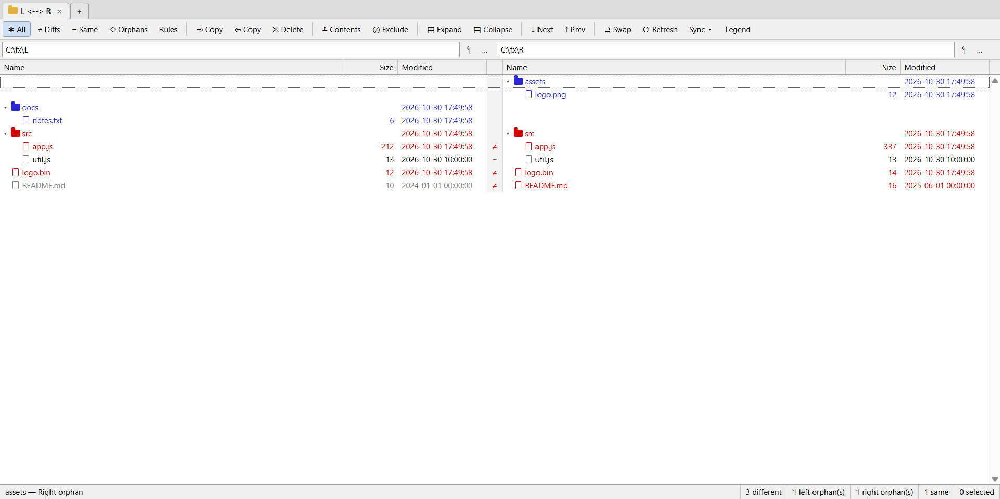
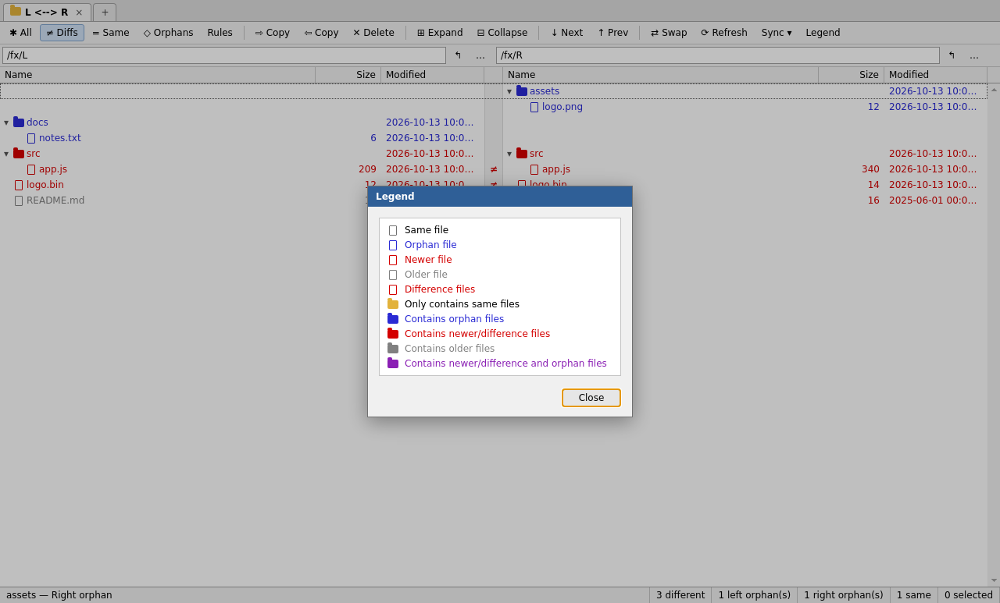
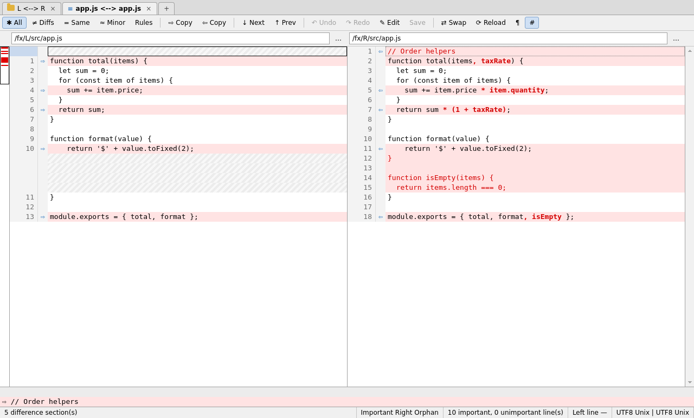
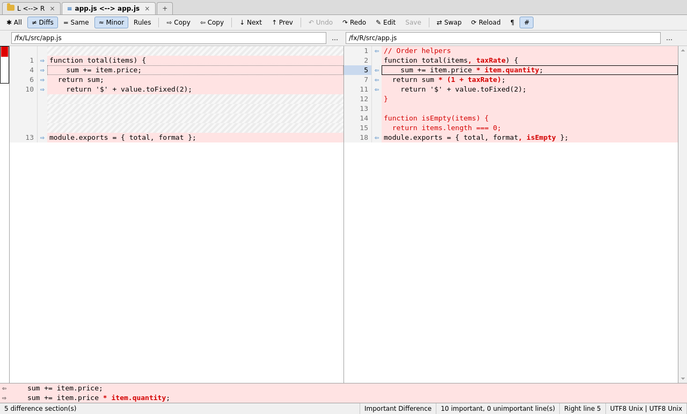
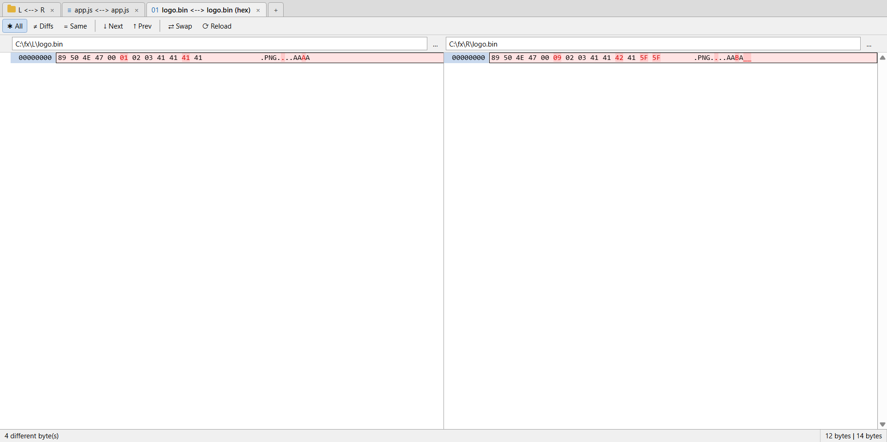

# Janus Diff — Ajuda

O Janus Diff compara pastas, arquivos de texto e arquivos binários lado a lado.
Ele mostra o que mudou, deixa você levar as diferenças de um lado para o outro e
salvar o resultado.

Os nomes de menus, botões e mensagens aparecem como estão na tela (em inglês).

---

## 1. Primeiros passos

### Tela inicial (Home)

Ao abrir o programa sem argumentos aparece a tela inicial, com:

- **Start new session**: três atalhos para começar uma comparação vazia:
  - **Folder Compare**: compara duas pastas.
  - **Text Compare**: compara e edita dois arquivos de texto.
  - **Hex Compare**: compara dois arquivos binários byte a byte.
- **Recent sessions**: as últimas 30 comparações feitas (tipo, caminhos da
  esquerda e da direita e data). Clique numa delas para reabri-la. Uma sessão
  só entra na lista quando os dois lados foram preenchidos.
- **Update**: aparece só quando há uma versão nova disponível (veja
  [Atualizar o Janus Diff](#atualizar-o-janus-diff)).

### Escolhendo o que comparar

Cada comparação tem uma caixa de caminho para a esquerda e outra para a direita,
logo abaixo da barra de ferramentas:

- Digite (ou cole) o caminho e pressione **Enter**.
- Ou clique no botão **…** ao lado da caixa para escolher num diálogo.
- Ou use **File → Open Left...** / **File → Open Right...**.
- Ou **arraste do Explorer** e solte na janela: na comparação de texto e na
  hexadecimal, solte o arquivo no painel desejado; na comparação de pastas,
  solte uma pasta na metade esquerda ou direita da janela (ou duas pastas de uma
  vez para preencher os dois lados).

Ao abrir dois arquivos (pela linha de comando, pelo Explorer ou a partir de uma
comparação de pastas), o Janus Diff escolhe a tela sozinho: **Text Compare**
para texto e **Hex Compare** se algum dos dois for binário.

### Abas

Cada comparação fica numa aba. Várias comparações podem ficar abertas ao mesmo
tempo.

| Ação | Como |
|---|---|
| Nova aba (abre a tela inicial) | **Ctrl+T** ou o botão **+** na barra de abas |
| Fechar aba | **Ctrl+W**, **Ctrl+F4**, o **×** da aba ou clique com o botão do meio |
| Próxima / aba anterior | **Ctrl+Tab** / **Ctrl+Shift+Tab** |

O título da aba mostra `esquerda <--> direita`. Um **\*** no fim indica
alterações não salvas. Ao fechar uma aba (ou o programa) com alterações
pendentes, o Janus Diff pergunta se deseja salvar.

### Comandos comuns a todas as comparações

| Comando | Onde | Atalho |
|---|---|---|
| Trocar os lados (esquerda ↔ direita) | **Session → Swap Sides**, botão **⇄ Swap** | — |
| Recarregar / comparar de novo | **Session → Reload / Refresh**, botão **⟳** | **F5** |
| Próxima / anterior diferença | **Search → Next/Previous Difference Section**, botões **↓ Next** / **↑ Prev** | **Ctrl+N** / **Ctrl+P** |
| Configurações da sessão | **Session → Session Settings...**, botão **Rules** | — |
| Lista de atalhos | **Help → Keyboard Shortcuts** | **F1** |
| Este guia | **Help → User Guide**, botão **User Guide** na lista de atalhos ou na tela inicial | — |

Os menus se adaptam à aba ativa: comandos que não se aplicam a ela (por exemplo,
**Save** numa comparação de pastas) aparecem desabilitados.

A **barra de status**, no rodapé, mostra contagens de diferenças, a posição
atual e mensagens explicando por que um comando não fez nada (por exemplo,
"Nothing to copy…").

### Atualizar o Janus Diff

Alguns segundos depois de abrir, o Janus Diff consulta em segundo plano a última
versão publicada no GitHub. Se houver uma mais nova, a tela inicial mostra o
quadro **Update** com o número da versão; nada mais é exibido, nem quando não há
novidade ou a consulta falha (por exemplo, sem internet). Quando o programa é
aberto pelo Git com `--wait`, essa consulta automática não é feita.

Para consultar a qualquer momento, use **Help → Check for Updates...**. Se houver
versão nova, uma janela mostra as novidades da versão e os botões:

- **Update Now**: baixa a nova versão, mostrando o progresso (**Cancel**
  interrompe o download). O arquivo baixado é conferido com o checksum
  SHA-256 publicado no GitHub antes de ser usado. Terminado o download, o
  Janus Diff pede confirmação, dá a cada aba com alterações não salvas a
  chance de salvar, fecha e:
  - **instalado** (pelo `Janus.Diff.Setup.X.Y.Z.exe`): roda o instalador
    novo sem janelas, na mesma pasta e no mesmo modo da instalação atual, e
    abre o programa de novo ao terminar. Se ele foi instalado para todos os
    usuários, o Windows pede permissão de administrador;
  - **portátil** (`Janus.Diff.X.Y.Z.exe`): salva o executável novo ao lado
    do atual (ou em **Downloads**, se essa pasta não aceitar gravação) e o
    abre. O executável antigo continua lá e pode ser apagado.
- **Release Page**: abre a página da versão no navegador.
- **Later**: fecha a janela; o quadro **Update** continua na tela inicial.

Rodando a partir do código-fonte, o programa não se atualiza sozinho: a janela
oferece só a página da versão.

---

## 2. Comparação de pastas (Folder Compare)

Mostra as duas árvores de pastas alinhadas linha a linha: cada arquivo ou pasta
aparece na mesma altura nos dois lados. Quando um item existe só de um lado, o
outro lado fica vazio naquela linha.



### Colunas e cores

Cada lado tem as colunas **Name**, **Size** e **Modified**. Entre os dois lados,
a coluna central mostra **=** (iguais) ou **≠** (diferentes).

A cor de cada item indica o resultado da comparação (veja **View → Legend**,
**Ctrl+Alt+L** ou o botão **Legend**):

| Arquivos | Significado |
|---|---|
| Same file | Iguais nos dois lados |
| Newer file | Este lado é o mais novo (ou os arquivos diferem sem diferença de data) |
| Older file | Este lado é o mais antigo |
| Orphan file | Existe só deste lado ("órfão") |

| Pastas | Significado |
|---|---|
| Only contains same files | Tudo dentro é igual |
| Contains newer/difference files | Há arquivos mais novos ou diferentes dentro |
| Contains older files | Há arquivos mais antigos dentro |
| Contains orphan files | Há itens que só existem deste lado |
| Contains newer/difference and orphan files | As duas situações acima |



A barra de status mostra o caminho e o resultado do item atual, e os totais:
diferentes, órfãos à esquerda, órfãos à direita, iguais e selecionados.
Durante a varredura ela mostra o progresso ("Scanning folders… N folders,
M files", "Comparing contents… N/M"). Em pastas muito grandes a varredura pode
levar um tempo; **Refresh**, outras pastas ou fechar a aba interrompem a
varredura em andamento. Links simbólicos e junções são seguidos, exceto quando
levam de volta a uma pasta acima deles (um laço): esses ficam vazios. Ao final,
a barra de status avisa quantas pastas não puderam ser lidas (sem permissão,
por exemplo) e quantos laços foram ignorados.

### Filtros de exibição

Botões na barra de ferramentas (também em **View**):

- **✱ All**: mostra tudo.
- **≠ Diffs**: só o que é diferente (inclui mais novos, mais antigos e órfãos).
- **= Same**: só o que é igual.
- **◇ Orphans**: só os itens que existem de um lado só.

Pastas que não têm nada a mostrar no filtro atual ficam ocultas.

### Navegação

| Ação | Como |
|---|---|
| Expandir / recolher uma pasta | clique na setinha ▸/▾, **→** / **←**, ou **Enter** |
| Expandir / recolher tudo | botões **⊞ Expand** / **⊟ Collapse**, **Edit → Expand All / Collapse All** |
| Abrir um par de arquivos numa nova aba | duplo clique ou **Enter** (abre texto ou hex conforme o conteúdo) |
| Próxima / anterior diferença | **Ctrl+N** / **Ctrl+P** — abre as pastas necessárias pelo caminho |
| Procurar pelo nome | **Ctrl+F**; **F3** / **Shift+F3** repetem para baixo / para cima (procura nas linhas visíveis) |
| Subir um nível (os dois lados) | **Backspace** |
| Subir um nível (só um lado) | botão **↰** ao lado da caixa de caminho |
| Mover o cursor | **↑ ↓**, **PgUp/PgDn**, **Home/End** |
| Escolher o lado ativo | clique no lado desejado, ou **Alt+←** / **Alt+→** |

O **lado ativo** (onde você clicou por último) é o lado afetado por Excluir,
Renomear e Nova pasta.

### Seleção

- Clique: seleciona um item.
- **Arrastar com o mouse**: seleciona um intervalo.
- **Shift+clique**: seleciona do item anterior até este.
- **Ctrl+clique**: inclui ou tira um item da seleção.
- **Shift+↑/↓/PgUp/PgDn/Home/End**: estende a seleção pelo teclado.
- **Ctrl+A**: seleciona tudo o que está visível.

Selecionar uma pasta equivale a selecionar tudo o que está dentro dela.

### Operações com arquivos

| Operação | Como | Observações |
|---|---|---|
| Copiar para a direita / esquerda | **Ctrl+R** / **Ctrl+L**, botões **⇨ Copy** / **⇦ Copy**, **Actions → Copy to Right/Left** | Pede confirmação e avisa quantos arquivos serão sobrescritos. Preserva as datas. Pastas são copiadas com todo o conteúdo. |
| Excluir | **Del**, botão **✕ Delete**, **Actions → Delete** | Envia para a Lixeira, do lado ativo. Se a Lixeira não estiver disponível naquele disco, oferece excluir permanentemente. |
| Excluir permanentemente | **Shift+Del**, **Actions → Delete Permanently** | Não passa pela Lixeira. |
| Renomear | **F2**, **Actions → Rename** | Renomeia o item do lado ativo. |
| Nova pasta | **Actions → New Folder...** | Cria no lado ativo, dentro da pasta atual (se ela estiver expandida) ou ao lado do item atual. |

Se alguma operação falhar em parte, aparece a lista dos itens com erro; os
demais são concluídos normalmente. Depois de cada operação a comparação é
refeita.

### Comparar o conteúdo da seleção (Ctrl+M)

Por padrão, as pastas são comparadas só por tamanho e data, o que é rápido mas
pode apontar como diferentes arquivos que só tiveram a data alterada. Para
tirar a dúvida, selecione arquivos ou pastas presentes nos dois lados e use
**Ctrl+M** (botão **≟ Contents**, **Actions → Compare Contents of
Selection...**). Escolha o método:

- **Rules-based**: compara como texto, aplicando as regras de importância
  (espaços, maiúsculas — ver seção 3). Arquivos binários são comparados byte a
  byte.
- **Binary**: compara byte a byte.
- **CRC**: compara pela soma de verificação CRC32.

O resultado substitui o de tamanho/data para esses itens até a próxima
atualização (F5). A barra de status informa quantos ficaram iguais e quantos
diferentes.

### Tirar itens da comparação (Ctrl+E)

**Ctrl+E** (botão **⊘ Exclude**, **Actions → Exclude from Comparison**) remove
os itens selecionados da comparação. Na prática, cada item vira um filtro de
exclusão (ex.: `-/src/gerado/`) nas configurações da sessão; para trazê-lo de
volta, abra **Rules** e apague o filtro.

### Configurações da sessão (Rules)

Botão **Rules** ou **Session → Session Settings...**:

**Quick tests** (rápidos, usam só as informações do arquivo):

- **Compare file size**: tamanhos diferentes = arquivos diferentes.
- **Compare timestamps**: datas de modificação diferentes = arquivos
  diferentes; indica qual lado é mais novo.
- **Second tolerance**: diferença de data, em segundos, que ainda é
  considerada igual (padrão 2, útil para discos FAT/rede).
- **Compare filename case**: se marcado, `Arquivo.txt` e `arquivo.txt` são
  tratados como itens diferentes.

**Requires opening files** (lê o conteúdo; mais lento):

- **Compare contents**: *(off)*, *CRC comparison*, *Binary comparison* ou
  *Rules-based comparison*.
- **Skip if quick tests indicate files are the same**: só lê o conteúdo dos
  arquivos que os testes rápidos já apontaram como diferentes.
- **Override quick test results**: o resultado do conteúdo prevalece (ex.:
  datas diferentes mas conteúdo igual → "igual").

**Name filters** — máscaras separadas por `;`:

| Máscara | Efeito |
|---|---|
| `*` | tudo (padrão) |
| `*.js;*.ts` | só arquivos com essas extensões |
| `-*.min.js` | exclui arquivos que casam com a máscara |
| `-node_modules/` | barra no final = vale para pastas |
| `-src/gen/` | com barra no meio, compara com o caminho relativo |
| `-/README.md` | barra no começo = só na raiz da comparação |

`*` vale qualquer sequência de caracteres e `?` um caractere; maiúsculas e
minúsculas não importam.

### Sincronizar pastas

Botão **Sync ▾** ou **Actions → Synchronize**:

- **Update Right**: copia para a direita os arquivos mais novos e os órfãos da
  esquerda.
- **Update Left**: o mesmo, no sentido contrário.
- **Update Both**: faz as duas coisas — cada lado recebe o que tem de mais novo
  no outro.
- **Mirror to Right**: deixa a direita idêntica à esquerda — copia tudo o que
  difere e **exclui** (para a Lixeira) o que só existe na direita.
- **Mirror to Left**: o mesmo, no sentido contrário.

Antes de começar, o Janus Diff mostra quantos itens serão copiados e excluídos
e pede confirmação. Se já estiver tudo sincronizado, ele avisa.

---

## 3. Comparação de texto (Text Compare)

Mostra os dois arquivos lado a lado, com as linhas correspondentes alinhadas.
Nas linhas que mudaram, os trechos alterados dentro da linha também são
destacados.



### O que você vê

- **Linhas iguais**: sem destaque.
- **Diferença importante**: em destaque forte (vermelho).
- **Diferença sem importância**: em destaque leve (azul) — por exemplo, só
  espaços no fim da linha, conforme as regras.
- **Linha órfã**: existe só de um lado; o outro lado mostra um espaço vazio.
- **Miniatura** (faixa à esquerda): o arquivo inteiro em miniatura, com as
  diferenças marcadas e um retângulo na parte visível. Clique ou arraste nela
  para ir até um ponto.
- **Painel de detalhes** (abaixo dos painéis): a linha atual da esquerda e da
  direita, uma sobre a outra, para comparar caractere a caractere.
- **Barra de status**: número de seções diferentes, tipo da linha atual,
  total de linhas importantes/sem importância, número da linha e, para cada
  lado, a codificação (UTF8, UTF16…) e o tipo de fim de linha (PC, Unix, Mac),
  além de "modified" quando há alterações não salvas.

Uma **seção** é um bloco contínuo de linhas diferentes.

### Filtros e exibição

| Botão | Efeito |
|---|---|
| **✱ All** | mostra todas as linhas |
| **≠ Diffs** | só as linhas diferentes, com até 5 linhas iguais de contexto antes e depois de cada trecho; uma linha tracejada marca onde há linhas ocultas (passe o mouse para ver quantas) |
| **= Same** | só as linhas iguais |
| **≈ Minor** | trata diferenças sem importância como iguais (**View → Ignore Unimportant Differences**) |
| **¶** | mostra espaços (·) e tabulações (→) (**View → Visible Whitespace**) |
| **#** | mostra/oculta os números de linha (**View → Line Numbers**) |

A rolagem horizontal dos dois painéis é sincronizada.

### Regras de importância (Rules)

Botão **Rules** ou **Session → Session Settings...** definem quais diferenças
contam como **importantes**:

- **Leading whitespace** — espaços no início da linha (padrão: importante).
- **Embedded whitespace** — espaços no meio da linha (padrão: importante).
- **Trailing whitespace** — espaços no fim da linha (padrão: sem importância).
- **Character case** — maiúsculas/minúsculas (padrão: importante).
- **Orphan lines are always important** — linhas que só existem de um lado
  (padrão: importante).

O que não for importante aparece como diferença leve e pode ser escondido com
**≈ Minor**.

### Navegação

| Ação | Atalho |
|---|---|
| Próxima / anterior seção diferente | **Ctrl+N** / **Ctrl+P** (ao abrir, o cursor já vai para a primeira) |
| Localizar texto | **Ctrl+F**; **F3** / **Shift+F3** para próximo/anterior (procura no lado ativo, sem diferenciar maiúsculas) |
| Ir para a linha | **Ctrl+G** (número da linha no lado ativo) |
| Mover o cursor | **↑ ↓**, **PgUp/PgDn**, **Home/End**, **Ctrl+Home/End** |
| Trocar o painel ativo | clique, **Alt+←** / **Alt+→**, ou **F6** |

### Seleção de linhas

- **Arrastar com o mouse** seleciona linhas, como num editor; passar da borda
  rola a lista.
- **Shift+clique** e **Shift+↑/↓/PgUp/PgDn/Home/End** estendem a seleção.
- **Ctrl+D** (**Edit → Select Section**) seleciona a seção diferente inteira
  sob o cursor.
- **Ctrl+A** seleciona tudo.
- **Ctrl+C** copia para a área de transferência o texto das linhas
  selecionadas (do lado ativo).

### Levando diferenças de um lado para o outro

Há três níveis:

**Seção inteira** — **Ctrl+R** (para a direita) / **Ctrl+L** (para a
esquerda), botões **⇨ Copy** / **⇦ Copy**, ou a seta dupla **⇨/⇦** que aparece
na margem da primeira linha de cada seção. Se houver uma seleção, copia
exatamente as linhas selecionadas.

**Só a linha** — **Ctrl+Shift+R** / **Ctrl+Shift+L**, botões **→ Line** /
**← Line**, ou a seta simples **→/←** na margem de cada linha diferente:

- uma linha alterada substitui a do outro lado;
- uma linha órfã é inserida no outro lado;
- clicar na seta de uma linha *vazia* remove a linha correspondente do outro
  lado;
- depois de copiar, o cursor pula para a próxima diferença, então dá para ir
  repetindo o atalho linha por linha.

**Shift+clique** na seta simples copia a seção inteira.

**Bloco selecionado** — selecione várias linhas e depois:

- clique numa seta → / ← dentro da seleção, ou
- clique no botão flutuante **→ Copy N lines** que aparece ao lado da seleção,
  ou
- use **Ctrl+Shift+R** / **Ctrl+Shift+L**.

O bloco inteiro vai para o outro lado e pode ser desfeito num único **Ctrl+Z**.

**Arrastar e soltar** — arraste uma seleção de várias linhas e solte-a no outro
painel: uma linha azul ("Insert N lines here") mostra onde as linhas serão
inseridas. **Esc** cancela o arraste.

**Menu de contexto** — clique com o botão direito numa linha para: copiar
linha(s) para a direita/esquerda, copiar a seção, editar a linha ou copiar o
texto.

### Alinhamento manual (F7)

Quando o alinhamento automático junta as linhas erradas, você pode indicar quais
linhas se correspondem:

1. Posicione o cursor numa linha e pressione **F7** (ou botão **⇅ Align**,
   **Edit → Align With...**). A linha fica contornada.
2. Clique na linha correspondente do outro lado (ou vá até ela e pressione
   **F7** de novo).

As duas linhas passam a ficar na mesma altura e o resto é recomparado em volta
delas. Linhas alinhadas à mão ganham uma marca laranja na margem. **Esc**
cancela a escolha. Um novo alinhamento que cruze outro anterior substitui o
anterior. O alinhamento pode ser desfeito com **Ctrl+Z**.

### Edição

| Ação | Como |
|---|---|
| Começar a editar | **um clique** no texto (o cursor fica onde você clicou), ou digite direto, ou **F2**, **Enter**, botão **✎ Edit** |
| Quebrar a linha | **Enter** — a edição continua na linha nova |
| Juntar duas linhas | **Backspace** no início da linha ou **Delete** no fim |
| Andar pelo texto | setas (atravessam o fim e o início das linhas), **Home**, **End**, **PgUp**, **PgDn**, **Ctrl+Home**, **Ctrl+End** |
| Selecionar texto na linha | arrastar dentro da linha, duplo clique na palavra, **Shift+←/→** |
| Colar várias linhas | **Ctrl+V** — cada quebra de linha vira uma linha |
| Inserir uma tabulação | **Tab** |
| Escrever onde só o outro lado tem linha | clique na lacuna (área listrada) e digite |
| Sair da edição | **Esc** descarta o que foi digitado na linha; clicar em outro lugar mantém |
| Inserir uma linha depois da atual | **Ctrl+Enter** |
| Excluir linha(s) inteira(s) | clique no número da linha (ou selecione as linhas) e **Del** |
| Desfazer / refazer | **Ctrl+Z** / **Ctrl+Y** (ou **Ctrl+Shift+Z**), botões **↶ Undo** / **↷ Redo** |

Nada vai para o disco enquanto você edita: só **Ctrl+S** grava o arquivo, e a
edição continua depois de salvar. A comparação é refeita quando você sai da
linha (com **Enter**, as setas ou um clique). Os outros atalhos da comparação,
como **Ctrl+N** e **Ctrl+Shift+R**, funcionam durante a edição.

O histórico guarda até 200 passos. Durante a edição, **Ctrl+Z** primeiro desfaz
o que foi digitado na linha e depois os passos anteriores.

### Salvar

- **Ctrl+S** (botão **Save**) salva os lados que foram alterados.
- **F12** (**File → Save As...**) salva o lado ativo com outro nome.
- A codificação original (UTF-8, UTF-8 com BOM, UTF-16 LE/BE, Latin-1) e o
  tipo de fim de linha (CRLF, LF, CR) são preservados, assim como a presença
  ou não de quebra de linha no final do arquivo.

### Arquivo alterado por outro programa

O Janus Diff verifica os arquivos abertos a cada poucos segundos e sempre que a
janela recebe o foco:

- Se um arquivo mudou no disco (por outro editor, um `git checkout` etc.) e não
  há edições pendentes daquele lado, ele é **recarregado automaticamente**. A
  barra de status avisa, e **Ctrl+Z** traz de volta o texto anterior.
- Se há edições pendentes, ele **não** é recarregado; a barra de status avisa e
  **F5** recarrega (descartando as edições, após confirmação).
- Se o arquivo foi apagado ou movido, a barra de status avisa.

### Diff unificado (patch)

- **Ctrl+Shift+C** (botão **Patch**, **Edit → Copy as Unified Diff**) copia as
  diferenças no formato *unified diff* para a área de transferência.
- **File → Save Patch...** salva o mesmo conteúdo num arquivo `.patch`.

O patch reflete o que está na tela, incluindo edições ainda não salvas e
alinhamentos manuais.

### Comparar com a área de transferência

Útil para comparar um trecho copiado de outro lugar:

- **Ctrl+Shift+V** (**Edit → Compare Clipboard (Current Side)**) coloca o texto
  da área de transferência no lado ativo.
- **Edit → Compare Clipboard as Left / as Right** escolhe o lado.

O lado fica marcado como "Clipboard text (not saved)". Ele pode ser editado e,
ao salvar, o programa pergunta onde gravar.



---

## 4. Comparação hexadecimal (Hex Compare)

Compara dois arquivos byte a byte, posição por posição (sem tentar alinhar
trechos inseridos). Cada linha mostra o endereço (offset, em hexadecimal), 16
bytes em hexadecimal e a mesma faixa em texto (caracteres não imprimíveis
aparecem como `.`). Os bytes diferentes ficam destacados.



| Ação | Como |
|---|---|
| Mostrar tudo / só diferenças / só iguais | botões **✱ All**, **≠ Diffs**, **= Same** |
| Próxima / anterior diferença | **Ctrl+N** / **Ctrl+P** |
| Ir para um endereço | **Ctrl+G** (offset em hexadecimal, ex.: `1A0`) |
| Mover | **↑ ↓**, **PgUp/PgDn**, **Ctrl+Home/End** |
| Trocar lados / recarregar | **⇄ Swap**, **F5** |

A barra de status mostra quantos bytes diferem (ou "Binary same") e o tamanho
de cada arquivo. O limite é de 64 MB por arquivo. A visualização hexadecimal é
somente leitura.

---

## 5. Integração com o Windows Explorer

O instalador adiciona opções ao menu de contexto (botão direito) do Explorer.
Rodando sem o instalador, use **Tools → Install Explorer Context Menu**. No
Windows 11 as opções ficam em **Mostrar mais opções**.

**Comparar dois itens em dois passos:**

1. Botão direito no primeiro arquivo → **Janus Diff: Select Left File** (ou
   **Select Left Folder** numa pasta).
2. Botão direito no segundo → **Janus Diff: Compare to "nome"**. A comparação
   abre e a escolha é limpa.

A opção "Compare to" só aparece para o mesmo tipo de item escolhido no passo 1
(arquivo com arquivo, pasta com pasta). Escolher **Select Left** de novo troca
o item memorizado.

**Comparar dois itens de uma vez:** selecione os dois no Explorer, botão
direito → **Janus Diff: Compare**. Com um único item selecionado, essa opção
abre o item sozinho no lado esquerdo. Com mais de dois, o programa avisa que é
preciso selecionar dois.

Para remover as opções: **Tools → Remove Explorer Context Menu** (o
desinstalador também as remove).

Se o Janus Diff já estiver aberto, as novas comparações abrem como abas na
mesma janela.

---

## 6. Integração com o Git

**Tools → Configure as Git Diff Tool** configura o Janus Diff como ferramenta de
diff do Git (no `~/.gitconfig` global). Depois disso:

```
git jd                       # abre um arquivo alterado por vez (o mais rápido)
git difftool                 # abre um arquivo alterado por vez
git difftool --dir-diff      # abre todas as mudanças numa comparação de pastas
```

Cada chamada abre uma janela própria; o Git continua quando ela é fechada.

`git jd` aceita os mesmos argumentos de `git diff` (por exemplo `git jd --cached`
ou `git jd HEAD~1 HEAD`) e abre bem mais rápido que `git difftool` no Windows.
O `git diff` normal continua mostrando o resultado no terminal.

Durante um conflito de merge, `git jd` sozinho mostra o diff combinado no terminal,
porque o Git não chama ferramentas externas nesse caso. Use `git jd --ours` ou
`git jd --theirs` para abrir o arquivo no Janus Diff.

A configuração põe `--` antes dos nomes de arquivo que o Git repassa, para que um
arquivo de repositório com nome começado por `--` não seja lido como opção do
programa. Uma configuração feita por versão anterior, sem o `--`, é corrigida
automaticamente na primeira vez que o Janus Diff abre (inclusive pelo `git jd`).

---

## 7. Linha de comando

```
JanusDiff <esquerda> [<direita>]     abre a comparação (pastas ou arquivos)
JanusDiff --wait <esq> <dir>         janela própria; o comando só termina quando ela fecha
JanusDiff --select-left <caminho>    memoriza o lado esquerdo (como no Explorer)
JanusDiff --compare-to <caminho>     compara o lado memorizado com este caminho
JanusDiff --register-shell           instala o menu de contexto do Explorer
JanusDiff --unregister-shell         remove o menu de contexto
JanusDiff --git-setup                configura o Git difftool e o alias git jd
JanusDiff --git-external <args>      recebe os argumentos do diff.external do Git (usado pelo git jd)
JanusDiff --version                  mostra a versão e sai
```

Sem `--wait`, se o programa já estiver aberto a comparação vira uma nova aba na
janela existente. Caminhos relativos são resolvidos a partir da pasta atual.
Depois de um `--` sozinho, tudo é tratado como caminho, mesmo começando com `-`.

---

## 8. Referência de atalhos

### Em qualquer tela

| Atalho | Ação |
|---|---|
| Ctrl+T | Nova aba |
| Ctrl+W, Ctrl+F4 | Fechar aba |
| Ctrl+Tab / Ctrl+Shift+Tab | Próxima / aba anterior |
| F1 | Lista de atalhos (com botão para este guia) |
| F5 | Atualizar / recarregar |
| Ctrl+N / Ctrl+P | Próxima / anterior diferença |

### Comparação de pastas

| Atalho | Ação |
|---|---|
| Enter, duplo clique | Abrir pasta / comparar arquivos |
| ← / → | Recolher / expandir pasta |
| Backspace | Subir um nível |
| Ctrl+R / Ctrl+L | Copiar para a direita / esquerda |
| Del / Shift+Del | Excluir (Lixeira) / excluir permanentemente |
| F2 | Renomear |
| Ctrl+M | Comparar o conteúdo da seleção |
| Ctrl+E | Tirar a seleção da comparação |
| Ctrl+A | Selecionar tudo |
| Shift+setas, Shift+PgUp/PgDn/Home/End | Estender a seleção |
| Ctrl+F, F3, Shift+F3 | Procurar nome, próximo, anterior |
| Alt+← / Alt+→ | Lado ativo: esquerda / direita |
| Ctrl+Alt+L | Legenda de cores |

### Comparação de texto

| Atalho | Ação |
|---|---|
| Ctrl+R / Ctrl+L | Copiar seção (ou seleção) para a direita / esquerda |
| Ctrl+Shift+R / Ctrl+Shift+L | Copiar só a(s) linha(s) e ir para a próxima diferença |
| F7 | Alinhar a linha com uma linha do outro lado |
| Esc | Cancelar alinhamento ou arraste |
| Clique no texto, F2, Enter | Editar (na edição, **Enter** quebra a linha e **Esc** descarta a digitação) |
| Ctrl+Enter | Inserir linha depois |
| Del | Excluir linha(s) selecionada(s); na edição, apagar o caractere |
| Ctrl+Z / Ctrl+Y | Desfazer / refazer |
| Ctrl+S / F12 | Salvar / salvar como |
| Ctrl+F, F3, Shift+F3 | Localizar, próximo, anterior |
| Ctrl+G | Ir para a linha |
| Ctrl+D | Selecionar a seção |
| Ctrl+A | Selecionar tudo |
| Shift+setas, Shift+PgUp/PgDn/Home/End | Estender a seleção |
| Ctrl+C | Copiar o texto das linhas |
| Ctrl+Shift+C | Copiar como diff unificado |
| Ctrl+Shift+V | Comparar com o texto da área de transferência |
| Alt+← / Alt+→, F6 | Trocar o painel ativo |

### Comparação hexadecimal

| Atalho | Ação |
|---|---|
| Ctrl+N / Ctrl+P | Próxima / anterior diferença |
| Ctrl+G | Ir para um endereço (hex) |
| Ctrl+Home / Ctrl+End | Início / fim |
| F5 | Recarregar |
